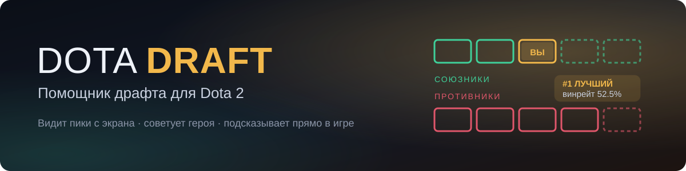
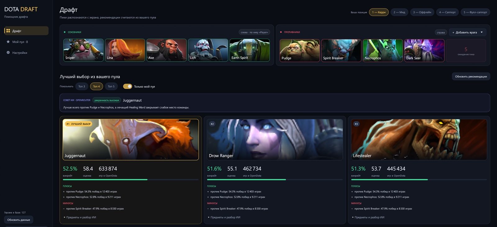
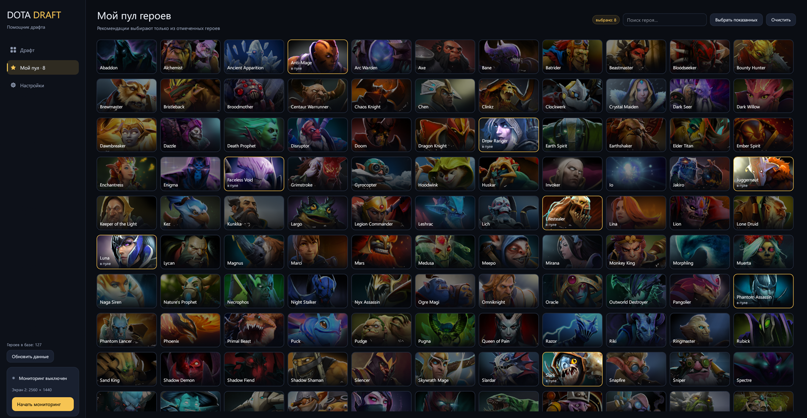

  

  
  
  
  

Помощник для стадии выбора героев в Dota 2. Программа сама видит, кого взяли союзники и противники, и подсказывает, кого пикнуть вам: с учётом контрпиков, синергии, вашей позиции и вашего пула героев. Подсказки показываются прямо поверх игры.

  

Файл <code>DotaDraftAssistant-&lt;версия&gt;.zip</code> · Windows 10/11, 64 бит · дальше программа обновляется сама

  

---

## Что умеет

- **Распознаёт драфт с экрана.** Читает портреты героев в верхней полосе и понимает, кто уже выбран у обеих команд. Серые (чёрно-белые) портреты, то есть героев, которых ещё не подтвердили, пиком не считает.
- **Рекомендует героев.** Даёт топ-3, 4 или 5 героев для вашей позиции по данным OpenDota: винрейт против вражеских героев, сочетание с союзниками и популярность на позиции. Можно ограничиться своим пулом героев.
- **Оверлей поверх игры.**
  - Подсвечивает рекомендованных героев прямо в сетке выбора.
  - Подписывает, где союзники, а где противники.
  - Обводит ваш слот золотой рамкой «ВЫ».
  - Окно оверлея не попадает в запись экрана и стримы.
- **Учитывает баны.** Забаненных и уже взятых героев программа видит в сетке и не рекомендует.
- **Включается сама.** Через официальную связь с Dota (Game State Integration) распознавание запускается с началом выбора героев и выключается после него.
- **Учится на ошибках.** Если герой распознан неверно, его можно поправить прямо на портрете. Программа запомнит, как он выглядит в игре.
- **Советы ИИ (по желанию).** Объяснение пика и сборка предметов от Groq или OpenRouter. Для этого нужен ваш собственный ключ API. ИИ получает только текстовый список героев, а не скриншоты.

<b>🖼 Ваш пул героев</b> — рекомендации можно ограничить героями, на которых вы играете

 

## Установка

1. Скачайте `DotaDraftAssistant-<версия>.zip` со [страницы релизов](https://github.com/timer23/DotaDraftAssistant/releases/latest).
2. Распакуйте в любую папку, например `C:\Games\DotaDraftAssistant`. Не запускайте программу прямо из архива.
3. Запустите `dota-draft-assistant.exe`.
4. Нажмите **«Обновить данные»**: программа загрузит героев и статистику из OpenDota.
5. В **Настройках** укажите монитор с игрой и свой ник в Dota. По нику программа понимает, с какой стороны ваша команда.

> **Windows может предупредить «Система Windows защитила ваш компьютер».** Программа без платной цифровой подписи, поэтому SmartScreen её не узнаёт. Нажмите **«Подробнее» → «Выполнить в любом случае»**. Если антивирус ругается на `hero_matcher_worker.exe`, добавьте папку программы в исключения: это распознаватель героев, собранный из Python.

## Связь с Dota (рекомендуется)

Чтобы распознавание само включалось на время драфта, а ваша сторона и герой брались прямо из игры:

1. В Steam: правой кнопкой по **Dota 2 → Свойства → Общие → Параметры запуска**.
2. Допишите `-gamestateintegration`.
3. Перезапустите Dota.

Файл настройки для Dota программа кладёт сама. В **Настройках** должно появиться «Dota на связи».

Valve не передаёт через эту связь чужие пики и баны, их программа по-прежнему читает с экрана.

## Как пользоваться

1. Запустите программу до начала матча. Её можно свернуть.
2. Игра должна быть в режиме **«Окно без рамки»** или **«На весь экран (оконный)»**: поверх «настоящего» полноэкранного режима оверлей не виден.
3. Когда начнётся выбор героев, распознавание включится само (или кнопкой **«Мониторинг»**).
4. Рекомендации появятся в оверлее и в окне программы и обновляются примерно раз в секунду.

Поддерживаются экраны 16:9 (1920×1080, 2560×1440 и другие).

## Обновления

Программа проверяет новую версию при каждом запуске. Если она есть, внизу окна появится **«Доступна версия … — Обновить»**. Скачиваются только изменившиеся файлы, каждый проверяется по контрольной сумме. После загрузки нажмите **«Перезапустить»**.

Во время драфта обновление не ставится. Проверить вручную можно в **Настройках → Обновления**.

## Конфиденциальность

- Скриншоты обрабатываются на вашем компьютере, не сохраняются и никуда не отправляются.
- В интернет программа ходит только на эти адреса:
  - OpenDota — статистика героев;
  - GitHub — проверка обновлений;
  - выбранный вами ИИ-сервис, если советы ИИ включены.
- Настройки хранятся в `%LOCALAPPDATA%\DotaDraftAssistant`.

## Частые вопросы

**Оверлей не виден поверх игры.** Переключите Dota в оконный режим без рамки.

**Программа путает героев.** Нажмите на неверный портрет в окне программы и выберите правильного героя. После пары исправлений программа начнёт узнавать его лучше.

**Перепутаны союзники и противники.** Проверьте ник в **Настройках** или включите связь с Dota (см. выше).

**«Данных от Dota пока нет».** Добавьте `-gamestateintegration` в параметры запуска и перезапустите Dota.

---

Программа не связана с Valve. Dota 2 — товарный знак Valve Corporation. Программа не читает память игры и не меняет её файлы: она только смотрит на экран и пользуется официальной Game State Integration. Для этой связи в папку Dota кладётся один файл настройки.
